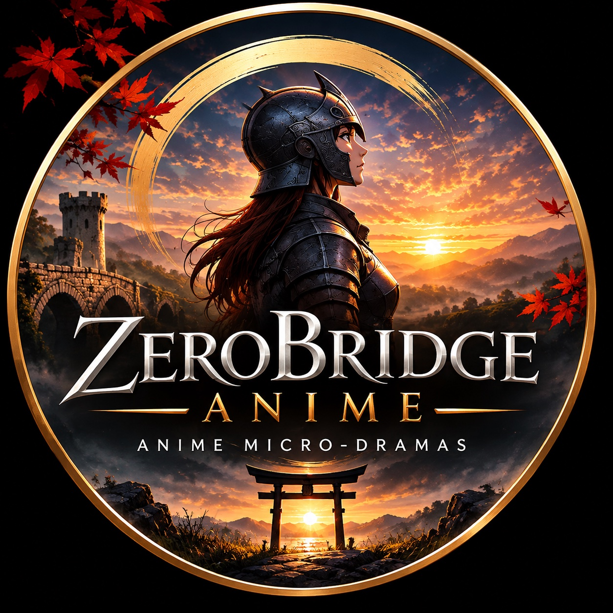

# ZERO BRIDGE

**Stories from other worlds in 60 seconds.**

ZERO BRIDGE is an anime micro-drama channel. Every episode is a complete story — one world, one character, one minute. Epic fantasy, sci-fi and beyond: a lone knight holding a bridge, an artillerist and her dog, a hunter who lowers her hammer. New episodes weekly.

## Watch

- 📺 **YouTube:** [@ZeroBridgeAnime](https://www.youtube.com/@ZeroBridgeAnime)
- 🌐 **Site:** https://aydea0260.github.io/zerobridge-anime/
- 👍 **Facebook:** ZeroBridge Anime — coming soon

## Episodes

**EP01 — The Last Guard of the Bridge** · *live now*
> "Nadie venía a relevarla. Y ella no se movió."

Episode in Spanish · 60 seconds · [Watch on YouTube](https://www.youtube.com/watch?v=gVEyRwXbmiQ)

**Coming next**

- EP02 — The Artillerist and Her Dog
- EP03 — The Huntress Who Lowered Her Hammer
- EP04 — Run, the Wings Will Catch You
- EP05 — The Two Masks
- EP06 — in production
- EP07 — in production

## About this repo

This repository is the home of the ZERO BRIDGE project site (`index.html`, published via GitHub Pages) and its brand assets (`assets/`). The canonical home of the episodes is the [YouTube channel](https://www.youtube.com/@ZeroBridgeAnime).
